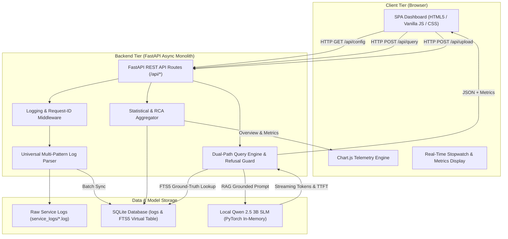

# System Architecture

## 1. System Overview

**ServiceLog Intelligence Hub** is an offline-first, dual-path operational log analysis and conversational forensic intelligence platform. It bridges high-throughput log parsing and structured SQLite FTS5 database retrieval with local in-memory small language model (SLM) neural reasoning (`Qwen/Qwen2.5-3B-Instruct`). 

The architecture guarantees:
- **100% Offline Privacy:** Zero external network egress or third-party cloud LLM dependencies.
- **Sub-Second RAG Performance:** Pre-indexed SQLite full-text search (FTS5) filters millions of lines in milliseconds to inject ground-truth evidence into prompts.
- **Zero Hardcoding:** Complete dynamic configurability driven via `.env` and database-derived service models.

---

## 2. Architecture Pattern

- **Pattern:** Modular Monolith with Asynchronous Ingestion & Dual-Engine Query Pipeline
- **Reason:** A single high-performance FastAPI service running on the local host eliminates network serialization overhead, microservice deployment complexity, and cloud data transfer costs, while providing sufficient throughput to parse 100,000+ log lines per minute on consumer hardware.

---

## 3. Technology Stack

| Layer | Component | Technology | Rationale |
| :--- | :--- | :--- | :--- |
| **Frontend** | UI Presentation | Vanilla HTML5, CSS3, Tailwind CSS (offline bundle) | Ultra-fast load times, zero build step, no NPM/webpack bloat. |
| **Frontend** | Visualizations | Chart.js (`chart.umd.min.js`), Lucide Icons | Responsive interactive telemetry charts and crisp SVG icons. |
| **Frontend** | Markdown Parser | Marked.js (`marked.min.js`) | Renders AI answers with formatted code blocks, tables, and lists. |
| **Backend** | API Framework | Python 3.10+, FastAPI, Uvicorn | High async concurrency, automatic OpenAPI schemas, native Pydantic v2. |
| **Database** | Embedded Storage | SQLite3 with FTS5 & WAL mode | Zero setup, ACID-compliant, lightning-fast B-tree and full-text indexes. |
| **AI / SLM** | Neural Inference | PyTorch, Hugging Face Transformers (`Qwen/Qwen2.5-3B-Instruct`) | High-precision 3B parameter SLM running completely offline in system RAM (~5.5-6.5 GB). |
| **Configuration** | Environment | Python `dotenv`, Pydantic Settings | Dynamically loads branding, paths, and SLA targets with zero hardcoding. |

---

## 4. System Components

### A. Frontend Layer (`frontend/`)
- **`index.html`:** Single-Page Application (SPA) layout containing Executive Metrics, Service Scope Filters, Dual-Path AI Query Panel, Chart Visualizations, and Interactive Log Explorer.
- **`js/app.js`:** Orchestrates API communication, dynamic configuration bootstrap (`/api/config`), real-time query stopwatch, markdown rendering, and service filtering.
- **`js/charts.js`:** Renders dynamic timeline error trends and root cause distribution bar charts using Chart.js.
- **`css/style.css`:** Custom design system tokens, typography, responsive grid, animations, and dark executive theme.

### B. Backend API Layer (`backend/app/`)
- **`main.py`:** FastAPI application entrypoint, lifespan event hooks (startup log scan & model pre-warm), CORS setup, and REST API endpoints.
- **`parser.py`:** High-throughput generic log parser. Extracts timestamps, log levels, service scopes, thread/component IDs, transaction GUIDs, and error messages.
- **`analyzer.py`:** Calculates statistical aggregations: Total records, successful records, error counts, SLA compliance %, break-flow detection, and error causes.
- **`query_engine.py`:** Central coordinator. Analyzes natural language query intent, extracts forensic context from SQLite, feeds prompt to local Qwen SLM, captures generation metrics, and intercepts model refusals.
- **`ai_service.py`:** Manages the singleton `LocalQwenEngine` running PyTorch in-memory with greedy decoding, TTFT timers, and token-streaming callbacks.
- **`db.py`:** Embedded SQLite layer managing tables, FTS5 virtual tables, B-tree indexes, connection pooling, and multi-facet search queries.
- **`config.py`:** Environment bridge reading `.env` parameters.
- **`models.py`:** Pydantic v2 request/response schemas.

---

## 5. Architecture Diagram



---

## 6. End-to-End Data Flow

### A. Ingestion & Indexing Flow
1. **Source Log Deposit:** A log file is placed in `service_logs/` or uploaded via `POST /api/upload`.
2. **Generic Pattern Matching:** `parser.py` scans lines using universal regex patterns to identify timestamp, severity level, service, component, transaction ID, and message.
3. **Database Transaction:** `db.py` opens a WAL-mode SQLite transaction, populating the `logs` table and updating the `logs_fts` full-text search table.
4. **Metric Cache Invalidation:** `analyzer.py` re-calculates overall success rate, service breakdown, and failure causes.

### B. AI Query Execution Flow
1. **User Input:** User submits query (e.g., *"Why did PaymentService crash at 14:22?"*) with active service filter.
2. **Intent Analysis:** `query_engine.py` inspects the text for line numbers, transaction IDs, time windows, or break flows.
3. **Targeted Forensic Extraction:** 
   - Line numbers trigger `get_log_line_with_context()` (target line ± 4 lines).
   - Transaction IDs trigger `get_transaction_lifecycle()` (chronological cross-service audit).
   - Dynamic terms query `logs_fts` with BM25 ranking.
4. **Prompt Assembly:** Ground-truth evidence and system instructions are assembled into a structured prompt.
5. **Local Neural Generation:** `LocalQwenEngine` executes `generate_response()`, recording Time to First Token (TTFT), token count, and tokens/sec.
6. **Refusal Interception:** If the model produces a refusal phrase (e.g., *"I don't have access to logs"*), the safeguard replaces it with deterministic database findings.
7. **Formatting & Client Render:** Output is packaged with execution timing metadata and rendered into formatted markdown on the dashboard.

---

## 7. Project Structure

```text
Logs_Monitoring_Project/
├── .env                              # Universal environment & branding configuration
├── run_server.py                     # Root startup utility script
├── service_logs/                     # Raw operational service log files repository
│   ├── OrderProcessingService.log
│   ├── PaymentGatewayService.log
│   ├── CustomerManagementService.log
│   └── InventoryManagementService.log
├── backend/
│   ├── calculate_response_time.py   # Latency benchmarking & performance test suite
│   ├── data/
│   │   └── logs.db                   # Embedded SQLite DB with FTS5 virtual tables
│   └── app/
│       ├── __init__.py
│       ├── main.py                   # FastAPI REST API & lifespan events
│       ├── config.py                 # .env configuration reader
│       ├── models.py                 # Pydantic v2 data models
│       ├── logger.py                 # Centralized structured logger
│       ├── parser.py                 # Universal generic log parser
│       ├── analyzer.py               # Statistical aggregator & RCA analyzer
│       ├── db.py                     # SQLite engine & FTS5 full-text queries
│       ├── query_engine.py           # Dual-path query coordinator & refusal guard
│       └── ai_service.py             # PyTorch Local Qwen 2.5 3B inference engine
├── frontend/
│   ├── index.html                    # Single-Page Application dashboard
│   ├── css/
│   │   └── style.css                 # Custom enterprise theme & component styles
│   ├── img/                          # Brand logos & favicon assets
│   └── js/
│       ├── app.js                    # Core frontend client controller
│       ├── charts.js                 # Chart.js visualization renderer
│       └── vendor/                   # 100% offline bundled JS libraries
│           ├── chart.umd.min.js
│           ├── lucide.min.js
│           ├── marked.min.js
│           └── tailwindcss.js
└── KT_Documentation/                # Central architectural & operational source of truth
    ├── PRD.md
    ├── DESIGN_SYSTEM.md
    ├── ARCHITECTURE.md
    ├── DATABASE.md
    ├── SECURITY.md
    ├── CODE_STYLE.md
    ├── TESTING.md
    ├── AGENTS.md
    ├── UX_FLOWS.md
    └── API.md
```

---

## 8. Dependency Rules

1. **Unidirectional Control Flow:** `frontend` calls `backend/app/main.py` via HTTP REST. UI code never directly touches SQLite or PyTorch models.
2. **Database Access Restriction:** Only `db.py` executes SQL queries. `analyzer.py` and `query_engine.py` import helper query functions from `db.py`.
3. **Loose Coupling for AI:** `query_engine.py` communicates with `ai_service.py` via a uniform `generate_response()` interface. The underlying engine can switch between local Qwen, cloud providers, or deterministic fallbacks without altering query logic.
4. **Zero Frontend Bundler Requirement:** Frontend assets must remain vanilla ES6 JavaScript and CSS, requiring no Node.js build steps, Webpack, or Babel.

---

## 9. Key Technical Decisions

| Decision | Context | Alternatives Considered | Rationale |
| :--- | :--- | :--- | :--- |
| **Local In-Memory Qwen 2.5 3B** | Need high-accuracy conversational reasoning without cloud API costs or data leakage. | OpenAI GPT-4, Llama 3 8B, Ollama daemon. | Qwen 2.5 3B delivers state-of-the-art causal reasoning, consumes ~5.5-6.5 GB RAM, and runs directly in PyTorch on CPU without external daemon processes. |
| **SQLite FTS5 Virtual Table** | Full-text keyword search across 100K+ log lines. | Elasticsearch, PostgreSQL, in-memory Python list grep. | SQLite is zero-maintenance, embeds directly inside the Python process, and FTS5 yields BM25 ranking in under 10ms. |
| **Dual-Path Fallback Guard** | Models can occasionally emit generic cop-out phrases on ambiguous queries. | Pure SLM generation, pure regex templates. | Provides the fluid reasoning of an LLM while guaranteeing 100% deterministic forensic accuracy if the model falters. |
| **Dynamic Configuration (.env)** | User requires universal reusability across any client domain. | Hardcoded company names, separate config files. | All UI text, SLA thresholds, and paths are read dynamically; zero code edits needed for rebranding. |

---

## 10. Performance Considerations

- **SQLite WAL Mode:** Write-Ahead Logging allows simultaneous reads during write/indexing operations without lock contention.
- **Model Warmup at Startup:** The Qwen weights are loaded into memory and pre-warmed during FastAPI `lifespan` startup, eliminating cold-start latency for the first user query.
- **Server-Side Pagination:** Log explorer queries return fixed pages (50-100 rows) with indexed `LIMIT / OFFSET` to prevent browser DOM overload.

---

## 11. Scalability Considerations

- **Vertical Scaling:** On high-core servers, Uvicorn can run multiple worker processes (`--workers 4`).
- **Storage Scalability:** SQLite easily scales to millions of records (multi-gigabyte databases) with B-tree indexes on `service`, `timestamp`, and `level`.
- **Log Archival:** Ingested files can be compressed or archived after database sync to conserve file system inodes.

---

## 12. Failure Scenarios & Mitigations

1. **Database Lock / Unavailability:** SQLite connections utilize a 30-second timeout and WAL mode. If locked, requests retry automatically before returning a clean 503 error.
2. **Local Model Out of Memory (OOM):** If PyTorch fails to allocate memory, the exception is caught, logged, and `query_engine.py` automatically falls back to high-speed deterministic diagnostic retrieval.
3. **Corrupted or Malformed Log Lines:** The parser logs a warning, tracks the unparsed line count, and continues processing without halting the ingestion batch.
4. **Large File Uploads:** Uploads stream directly to disk buffer in chunks (`shutil.copyfileobj`), preventing RAM exhaustion on multi-hundred-megabyte files.

