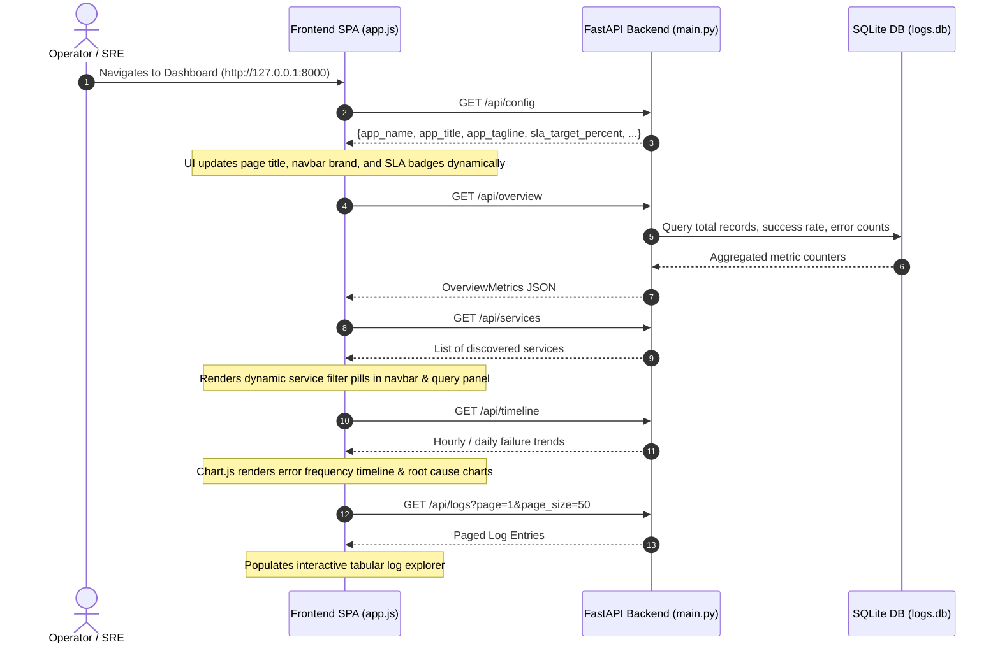

# User Experience (UX) Flows

## Overview

This document maps the primary user journeys through the **ServiceLog Intelligence Hub**, from initial dashboard bootstrap to deep forensic query inspection and file uploads. Every flow details user actions, frontend state changes, backend API calls, and edge-case handling.

---

## Flow 1: Dashboard Initialization & Dynamic Configuration



### States
- **Loading State:** Skeleton loader bars shimmer across the four executive metric cards.
- **Empty State:** If no log files are present in `service_logs/`, metric cards show `0`, and an alert banner prompts: *"No service logs detected. Please upload or deposit logs into service_logs/"*.
- **Success State:** Dynamic branding, SLA badge (`SLA: 95.0%`), real-time metric cards, Chart.js graphs, and the initial 50 log rows render crisply.
- **Error State:** If the backend is unreachable, a persistent crimson banner appears: *"Unable to connect to backend server at 127.0.0.1:8000. Retrying in 5s..."*.

---

## Flow 2: Natural Language Operational Question & Dual-Path AI Response

```mermaid
sequenceDiagram
    autonumber
    actor User as Operator / SRE
    participant UI as Frontend (app.js)
    participant API as FastAPI (main.py)
    participant QE as QueryEngine (query_engine.py)
    participant DB as SQLite FTS5 (db.py)
    participant SLM as Local Qwen 2.5 SLM (ai_service.py)

    User->>UI: Enters query ("Why did payment service fail?")
    User->>UI: Selects service filter pill (e.g. "PaymentGatewayService")
    User->>UI: Clicks "Ask AI" or presses Enter
    Note over UI: Launches real-time stopwatch counter; shows pulsing spinner
    UI->>API: POST /api/query {query: "...", service: "PaymentGatewayService"}
    API->>QE: answer_query(query, service)
    QE->>DB: Targeted RAG extraction (FTS5 search, error signatures, breaks)
    DB-->>QE: Ground-truth log evidence & metrics
    QE->>SLM: Dispatches grounded context prompt
    SLM-->>QE: Streaming generated tokens + TTFT + speed (tok/s)
    Note over QE: Checks for refusal phrases; attaches forensic tables
    QE-->>API: QueryResponse JSON
    API-->>UI: HTTP 200 {answer, category, metrics, evidence, duration_ms}
    Note over UI: Clears stopwatch; compiles Markdown via Marked.js; updates telemetry badges
```

### States
- **Loading State:**
  - Submit button shows spinning SVG loader and text *"Analyzing Logs..."*.
  - Query response container unhides with pulsating skeleton placeholders.
  - Active stopwatch counts elapsed time in seconds and tenths (`0.1s`, `0.2s`, `1.4s...`).
- **Success State:**
  - Stopwatch stops and displays total duration (e.g., `2.15s`).
  - Telemetry badges render:
    - **Model Pill:** `Local Qwen 2.5 (Qwen/Qwen2.5-3B-Instruct)`
    - **Scope Pill:** `PaymentGatewayService`
    - **Speed Pill:** `58.4 tok/s | TTFT: 0.285s`
    - **Duration Pill:** `2.15 s (2,150.4 ms)`
  - Formatted Markdown answer displays with syntax-highlighted code blocks, tables, and exact file/line references.
  - Smooth-scroll brings response container into focus.
- **Empty / Ambiguous Query State:**
  - If user submits an empty query, UI displays a warning: *"Please enter an operational question"*.
- **Error State:**
  - If the query fails, a styled error card renders with the backend error message, request ID, and a **Retry Query** action button.

---

## Flow 3: Tabular Log Filtering & Search Refinement

1. **User Action:** Operator navigates to the **Interactive Log Explorer** section.
2. **Filter Interactions:**
   - Clicks a **Service** dropdown option (e.g., `OrderProcessingService`).
   - Clicks a **Severity Level** button (e.g., `ERROR`).
   - Enters a search keyword in the full-text search box (e.g., `NullReferenceException`).
   - Selects a **Date** from the datepicker.
3. **Frontend Processing:** Debounces search input by 300ms, resets page counter to `1`, and dispatches `GET /api/logs?service=OrderProcessingService&level=ERROR&search=NullReferenceException&page=1&page_size=50`.
4. **Backend Processing:**
   - Parameterized SQL query filters `service_logs` table.
   - If keyword search is provided, joins against `service_logs_fts` using SQLite FTS5 MATCH operator.
   - Calculates total match count and returns slice for requested page.
5. **UI Update:** Re-renders table rows with colored severity pills (`red` for ERROR, `amber` for WARN, `blue` for INFO). Updates pagination footer: *"Showing 1-50 of 342 matching entries"*.

---

## Flow 4: Log File Upload & Automatic Reindexing

```mermaid
sequenceDiagram
    autonumber
    actor User as Operator
    participant UI as Frontend Upload Modal
    participant API as FastAPI (/api/upload)
    participant Disk as Local File System (service_logs/)
    participant Parser as Generic Parser (parser.py)
    participant DB as SQLite DB (logs.db)

    User->>UI: Clicks "Upload Log File" button
    Note over UI: Opens upload modal dialog
    User->>UI: Drags & drops or selects "AuthService.log"
    User->>UI: Clicks "Upload & Reindex"
    Note over UI: Shows upload progress bar
    UI->>API: POST /api/upload (multipart/form-data)
    Note over API: Validates .log extension; sanitizes filename
    API->>Disk: Streams bytes to service_logs/AuthService.log
    API->>Parser: parser.parse_all(force=True)
    Parser-->>API: Extracted structured LogEntry objects
    API->>DB: sync_logs_to_db(entries, force=True)
    DB-->>API: Updated database commit
    API-->>UI: HTTP 200 {status: "uploaded", filename: "AuthService.log", total_entries: 45200}
    Note over UI: Displays success toast notification; refreshes overview cards & service dropdowns
```

### States
- **Invalid File Type:** If a user selects `app.exe` or `data.csv`, client validation blocks upload immediately with alert: *"Only files ending in .log are permitted."*
- **Upload In-Progress:** Modal displays animated progress bar with percentage indicator.
- **Success State:** Modal closes; a green toast alert confirms upload; service list updates dynamically with the newly added service name.

---

## Flow 5: Chronological Transaction Lifecycle Audit

1. **User Action:** Operator notices a failed customer payment and types:
   *"Trace transaction TX-88419 across all services"*
2. **Backend Detection:** `query_engine.py` executes regex matching for transaction identifiers (`TX-88419`).
3. **Database Retrieval:** Invokes `get_transaction_lifecycle("TX-88419")`, which queries SQLite:
   ```sql
   SELECT file_name, line_number, timestamp, level, service, component, message
   FROM service_logs
   WHERE transaction_id = ?
   ORDER BY timestamp ASC, id ASC;
   ```
4. **Audit Table Generation:** Constructs a chronological markdown table mapping each execution hop:
   - Step 1: `OrderProcessingService` received order.
   - Step 2: `CustomerManagementService` validated account credentials.
   - Step 3: `PaymentGatewayService` encountered timeout / gateway rejection.
   - Step 4: `OrderProcessingService` received abort signal and halted flow.
5. **UI Rendering:** Displays the synthesized AI explanation followed by the complete chronological audit table.

---

## Flow 6: Exact File Line Number Context Inspection

1. **User Action:** Operator reviews a stack trace referencing line 204 in `CustomerManagementService.log` and asks:
   *"Inspect line 204 in CustomerManagementService.log"*
2. **Backend Processing:**
   - Regex matches target line `204` and scope `CustomerManagementService`.
   - `get_log_line_with_context(service="CustomerManagementService", target_line=204, context_lines=4)` queries:
     - Target log line 204.
     - 4 preceding lines (200, 201, 202, 203).
     - 4 succeeding lines (205, 206, 207, 208).
3. **UI Rendering:** Renders a syntax-highlighted forensic code inspection window inside the response:
   ```text
   Line   200: [14:20:10] [INFO ] Initiating customer profile retrieval
   Line   201: [14:20:11] [INFO ] Database connection pool acquired
   Line   202: [14:20:11] [DEBUG] Executing SELECT * FROM customers WHERE id = 4021
   Line   203: [14:20:12] [INFO ] Record found; decrypting customer PII fields
   ▶ Line 204: [14:20:12] [ERROR] CryptographicException: Padding is invalid and cannot be removed.
   Line   205: [14:20:12] [WARN ] Fallback decryption failed; returning null profile
   Line   206: [14:20:13] [INFO ] Releasing database connection
   Line   207: [14:20:13] [ERROR] Service break: Customer profile pipeline aborted prematurely
   Line   208: [14:20:14] [INFO ] HTTP 500 response returned to caller
   ```

